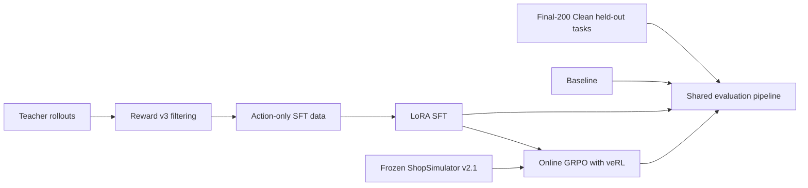
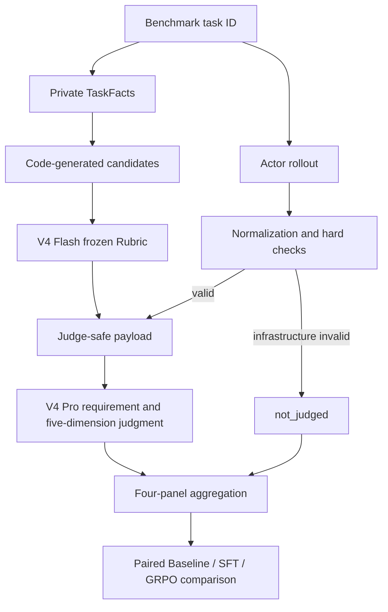

# Shopping GRPO

<div align="center">

**English** · [简体中文](README.md)

<br />

Reproducible post-training and evaluation for long-horizon shopping agents

<br />

[](pyproject.toml)
[](docs/sft.md)
[](https://github.com/verl-project/verl)
[](https://arxiv.org/pdf/2601.18225)
[](docs/evaluation-dataset.md)

<br />

Teacher rollouts and LoRA SFT → online GRPO with veRL → auditable comparison on
a frozen benchmark

<br />

**Current result: Qwen3.5-2B + LoRA SFT + GRPO = 128 / 200 (64.0%)**
　·　**+64 percentage points** over the untrained 2B baseline (0.0%)
　·　**+1 task** over SFT alone (63.5%), with **zero regression** — the set GRPO
solves is a strict superset of the set SFT solves

</div>


## What is ShopSimulator?

[ShopSimulator](https://arxiv.org/pdf/2601.18225) is a large-scale Chinese
shopping environment for evaluating long-horizon LLM agents. A task describes
what a user wants—including category, budget, brand, model, functions and
product options—but the agent must discover the right item through interaction.

In this project the agent can search products, open candidates, inspect details,
select variants, buy, or stop when no acceptable item can be verified. Success
therefore requires more than producing a plausible answer: the agent must gather
evidence, obey constraints, choose the correct variant and terminate correctly.

The frozen Environment v2.1 source and product archive are embedded under
[`environments/ShopSimulator/`](environments/ShopSimulator/), so the tutorial
does not depend on a separately running third-party repository.


## The four stages

| Stage | What happens | Entry point | Details |
|---|---|---|---|
| Baseline | Evaluate the untouched base model | `bash scripts/baseline.sh` | [Evaluation](docs/evaluation.md) |
| SFT | Learn tool use from accepted teacher trajectories | `bash scripts/sft.sh` | [SFT](docs/sft.md) |
| GRPO | Optimize terminal Reward v3 with online rollouts | `bash scripts/grpo.sh` | [GRPO](docs/grpo.md) |
| Evaluation | Run the curated Final-200 Clean protocol | `bash scripts/evaluate.sh NAME` | [Evaluation](docs/evaluation.md) |

The checked-in SFT data was produced by a separate collection stage documented
in [Data collection](docs/data-collection.md). The custom constraint-aware
reward is specified in [Reward v3](docs/reward-v3.md).



### How the SFT data was collected

The current collection used `deepseek-v4-flash` as a teacher in ShopSimulator
Environment v2.1. It produced 2,498 raw trajectories, of which 1,026 passed the
strict acceptance filter. This project then ran two data-rebuild rounds (see
[project history](docs/project-history.md)), ending with a **1,210-row pool**
(1,089 train / 121 validation), of which **144 rows (11.9%) contain `next_page`
paging demonstrations** — the main lever that moved SFT from 60.5% to 63.5%.
SFT, GRPO and Final-200 Clean task IDs are pairwise disjoint. Dataset hashes and
the audit are in [Data collection](docs/data-collection.md).

The resumable collection entry point is:

```bash
python scripts/collect_sft_data.py \
  --tasks data/grpo/train.jsonl \
  --output-dir outputs/sft-collection \
  --target-accepted 1000 \
  --workers 4
```

### How GRPO is trained

GRPO starts from the merged SFT model. veRL generates four online trajectories
per prompt in ShopSimulator, while deterministic Reward v3 scores the terminal
purchase, constraint satisfaction and termination behavior. No additional
LLM-as-a-Judge reward model is used for training.

The repository pins `verl==0.8.0` instead of copying its source. It keeps only
the project-specific AgentLoop, tool adapter, runtime compatibility code and a
small SHA-256-checked patch. See the [GRPO guide](docs/grpo.md) for details.

### How evaluation works

Formal evaluation combines deterministic checks with two LLM-as-Judge roles.
DeepSeek V4 Flash curates a frozen requirement Rubric from code-generated
category, brand, model, function, option and price candidates. It may select and
deduplicate candidates, but cannot invent fields or expected values. The same
Rubric is shared by Baseline, SFT and GRPO.

After each Actor completes a rollout, code normalizes events and computes
Reward, legality, repetition, context and infrastructure checks. Valid
trajectories then go to DeepSeek V4 Pro with the original Query, frozen Rubric,
Actor-visible trajectory, neutral terminal flags and allowlisted behavioral
metrics. Reward values, hidden Gold fields, raw observations, success labels and
other models' results are excluded.



V4 Pro scores Search Strategy, Candidate Utilization, Evidence Verification,
Decision Quality and Termination Efficiency independently on a 0/1/2 scale. It
also assesses each Rubric and assigns errors from a frozen taxonomy. The final
report keeps Reward/terminal, requirement Rubric, trajectory quality and
deterministic behavior as four separate panels—there is no composite score.
Failed, missing and not-judged tasks remain in the Final-200 Clean denominator. The
[evaluation guide](docs/evaluation.md) contains the complete prompts, one
worked benchmark example, input-isolation rules and aggregation contract. An
historical static view is available in the [Final-200 Benchmark Dashboard](docs/evaluation-dashboard.html); the current task set is documented in [Final-200 Clean](docs/evaluation-dataset.md).

> **Reserved figure — Training and evaluation pipeline.** A full-width diagram
> showing teacher data collection, LoRA SFT, online GRPO rollouts and the shared
> held-out evaluation path, with artifacts produced at each boundary.

## Results

All numbers are on **Final-200 Clean**: 200 held-out tasks, one deterministic
rollout per task (temperature 0). Strict success requires a `gold_purchase`
terminal state. Full protocol and artifact hashes:
[evaluation update log](docs/evaluation-updates.md).

### Main line

| Model | Strict success | Δ vs previous | Artifact |
|---|---:|---:|---|
| Qwen3.5-2B baseline (no post-training) | 0.0% | — | — |
| + LoRA SFT (initial) | 60.5% | +60.5pp | `experiments/sft/` |
| + LoRA SFT (behavior-coverage rebuild, M10-R v2) | **63.5% (127/200)** | +3.0pp | `sft-m10r/stage-full/merged` |
| **+ GRPO (medium-difficulty pool, M12, 50 steps)** | **64.0% (128/200)** | **+0.5pp** | `grpo-m12-merged` |
| `deepseek-v4-flash` (teacher, reference ceiling) | 73.5% (147/200) | — | — |
| Qwen3.8-27B (reference, not produced here) | 73.0% | — | — |

### Per-task delta of GRPO — the core finding

| Item | Count |
|---|---:|
| GRPO correct | **128** |
| SFT baseline correct | 127 |
| Both correct | 127 |
| **Only GRPO correct** | **1** |
| **Only SFT correct** | **0** |

**The 128 tasks GRPO solves are a strict superset of the 127 the SFT model
solves** — zero regression, one net gain. This is the first non-zero delta across
twelve stages. The three earlier GRPO attempts either tied (M6), crashed at step
48 (M6-R), or lost one task (M11 probe, whose 126 successes were a strict
*subset* of the baseline's 127 — the opposite direction).

> **Honest caveat**: +1 task sits inside binomial noise (σ ≈ 6.9 tasks). At the
> aggregate level 64.0% and 63.5% are indistinguishable. The defensible claim is
> "unique successes went from 0 to 1", not "success rate improved by 0.5pp".
> Statistical separation would require ≥134 tasks (+7).

### Where the 0.5pp came from

The first two GRPO rounds spun in place for a measurable reason: the training log
showed `group/all_equal_ratio` **0.25–0.50** and `no_purchase_success_ratio`
**0.375–0.75** — a quarter to a half of all groups had four identical rewards
(all correct or all wrong), so the within-group advantage was identically zero.
Those prompts burned compute without producing a gradient direction.

M12 changed **only the training data**: two sampling rounds labeled each
candidate task by "how many of 4 rollouts succeed", and only the
**medium-difficulty** ones (1–3 of 4, 223 tasks) were kept. Every other
hyperparameter stayed fixed.

| Metric | Before | After |
|---|---:|---:|
| `no_purchase_success_ratio` (all-wrong groups) | 0.375–0.75 | **0.00** |
| `all_equal_ratio` (zero-gradient groups) | 0.25–0.50 | 0.25 |
| Final-200 | 127 | **128** |

**All-wrong groups were eliminated entirely** — direct evidence that the pool
swap worked. The residual 0.25 are all *all-correct* groups: medium-difficulty
tasks degrade into easy ones during training. That is the structural ceiling of
this route.

### Paths tried and closed

| Direction | Result |
|---|---|
| Change GRPO recipe (lr 5e-6 → 2e-5) | val below start, circuit-breaker at step 48 |
| Force "open k candidates before buying" at inference | same 9 tasks **7/9 → 0/9** (p≈0.016), direction rejected |
| Teach paging (144 synthetic demonstrations) | 63.5%, but only 7 of 21 paging tasks actually paged; per-turn rationales dropped it to 61.5% |
| Rewrite search queries via system prompt | 127/200, net 0 (5 gained, 5 lost) |
| Hard-task pool (201 tasks with gold beyond rank 20) | 63.5%, only 2 tasks changed per-task ⇒ no signal |
| Reward v5 (`wrong_purchase` as a band) | Gate 3 gradient share 0.3% ≪ 5% threshold, never trained |

Full attribution and interpretation rules: [`docs/project-history.md`](docs/project-history.md)
and [`docs/lessons-learned.md`](docs/lessons-learned.md). Machine-readable
training configs and result summaries live in [`experiments/`](experiments/).
These are reported results, not a promise that different hardware or dependency
versions will produce bit-identical training.

## Training hardware and time

### GRPO (veRL 0.8, single GPU)

**GPU memory is the hard constraint.** Measured on M12 (50 steps):

| Item | Measured |
|---|---:|
| `actor/perf/max_memory_allocated_gb` | **41.3 GB** |
| `actor/perf/max_memory_reserved_gb` | **57.1 GB** |

⇒ **A 48 GB card does not fit** (47.9 GB usable). A previous 48 GB smoke run peaked
at 47,641 / 48,507 = 98.2% and crashed in `logprobs_from_logits → F.log_softmax`
(the 248,320-row vocabulary output layer is the culprit). **Minimum 64 GB,
recommended 80 GB+**, and `PYTORCH_CUDA_ALLOC_CONF=expandable_segments:True` is
mandatory.

| Stage | Time |
|---|---:|
| vLLM initialisation (GPU util stays at 0 — this is normal) | 20–25 min |
| Per step (`timing_s/step`) | **140–149 s** |
| ├ `update_actor` | **103–105 s** |
| ├ `gen` (rollout) | 12–19 s |
| └ `save_checkpoint` | 17 s |
| **50 steps including initialisation** | **2 h 23 min** |

**The wall-clock bottleneck is the actor update, not rollout** — shortening
responses or raising the batch size saves little.

### Evaluation (run separately)

A 2B model needs far less memory to evaluate than to train; **a 48 GB card is
enough**. One hard constraint: **do not use a Blackwell / sm_120 card** (e.g.
RTX 6000D). With torch CUDA < 12.9, `vllm serve` fails with
`FlashInfer requires sm75 or higher`. This project therefore splits training and
evaluation across two machines.

| Stage | Time |
|---|---:|
| vLLM loading the merged weights | 20–25 min |
| Final-200 evaluation (8 shards) | **~25 min** |
| Merging an FSDP checkpoint (11 GB → 4.2 GB weights) | ~15 min |

### SFT (LoRA)

| Item | Measured |
|---|---:|
| Per step | ~74 s |
| Total steps | 133 (1,061 kept examples ÷ batch 8) |
| Full training | ~2.7 h |

### Other stages

| Stage | Estimated time |
|---|---:|
| Teacher collection (2,498 raw trajectories) | Depends on endpoint concurrency and rate limits |
| Difficulty labelling for 1,000 tasks (2 rounds, 8-way) | **~4 h** |
| Final-200 Clean evaluation (Base) | ~20 min |
| Final-200 Clean evaluation (SFT/GRPO) | ~25 min |
| LLM Judge scoring for 200 trajectories | ~30–60 min |

## Requirements

- Linux with an NVIDIA GPU and a compatible CUDA driver;
- [`uv`](https://docs.astral.sh/uv/);
- about **60 GB** of free disk for environments, weights and generated artifacts
  (**each GRPO checkpoint is ~11 GB**);
- **SFT**: 48 GB of GPU memory is enough;
- **GRPO**: minimum **64 GB**, recommended **80 GB+**
  (measured `allocated 41.3 GB` / `reserved 57.1 GB`);
- **Evaluation**: 48 GB is enough, but **do not use a Blackwell / sm_120 card**
  (torch CUDA < 12.9 makes `vllm serve` fail with `FlashInfer requires sm75 or higher`).

The main environment uses Python 3.12. ShopSimulator is isolated on Python 3.10.
`uv` creates both environments. veRL is **installed as the pinned
`verl==0.8.0` dependency**; its source is not copied into this repository. Only
the Shopping Agent adapter and a small version-checked patch live here.

## Quick start

Run every command from the repository root.

### 1. Install

```bash
bash scripts/setup.sh
```

This installs the pinned SFT and GRPO dependencies, creates the isolated
ShopSimulator environment, verifies and expands the product archive, builds the
search index and applies the version-checked veRL patch.

### 2. Start ShopSimulator

Keep this terminal running:

```bash
bash scripts/start_environment.sh
```

The service listens on `http://127.0.0.1:5700`.

### 3. Evaluate the baseline

Start the base model server in a second terminal:

```bash
bash scripts/serve_model.sh Qwen/Qwen3.5-2B
```

Evaluate it in a third terminal:

```bash
bash scripts/baseline.sh
```

Stop the model server before training so it releases the GPU.

### 4. Train and evaluate SFT

```bash
bash scripts/sft.sh
bash scripts/serve_model.sh outputs/models/sft-merged
bash scripts/evaluate.sh sft
```

Stop the model server again before GRPO.

### 5. Train GRPO

First inspect the fully resolved launcher without starting CUDA or Ray:

```bash
bash scripts/grpo.sh --dry-run
```

Then train:

```bash
bash scripts/grpo.sh
```

Choose a checkpoint using validation metrics and export its actor:

```bash
bash scripts/export_grpo.sh \
  outputs/models/grpo/global_step_100/actor \
  outputs/models/grpo-merged
```

Evaluate it:

```bash
bash scripts/serve_model.sh outputs/models/grpo-merged
bash scripts/evaluate.sh grpo
```

Generated checkpoints, rollouts and logs are written under `outputs/`, which is
ignored by Git.

## Reward V3 overview

Reward v3 is a deterministic terminal reward; it does not rely on another
language model for subjective judgment:

- category and budget are hard gates;
- brand, model, core functions and key options use weights of
  `0.35 / 0.25 / 0.25 / 0.15`;
- an exact target purchase with full satisfaction receives `1.0`;
- a fully satisfying alternative item receives `0.55`;
- partial satisfaction receives a continuous score capped at `0.25`;
- wrong purchases, premature abstention, repeat loops and maximum-step
  termination receive distinct negative rewards;
- insufficient evidence sets `reward_valid=false`, rather than being treated as
  a valid neutral zero.


The complete formula, termination rules and evidence requirements are in the
[Reward v3 design guide](docs/reward-v3.md).

## Repository map

```text
configs/                         current GRPO, AgentLoop and tool configuration
data/
  sft/                           800 train + 200 validation trajectories
  grpo/                          ready-to-train JSONL and veRL Parquet
  evaluation/                    curated Final-200 Clean held-out set
docs/                            one guide for each tutorial stage and Reward v3
environments/ShopSimulator/      embedded environment and product archive
experiments/
  baseline/                      baseline config and result summary
  sft/                           SFT config and result summary
  grpo/                          GRPO config and result summary
scripts/                         thin user-facing tutorial entry points
src/shopping_grpo/
  collection/                    Teacher acceptance and SFT data construction
  environment/                   HTTP client, tools, actions and observations
  training/sft/                  SFT dataset masking and collation
  training/grpo/                 veRL adapter, compatibility and sampling logic
  evaluation/                    hard checks, Rubrics, trajectory Judge and metrics
tests/                           focused unit, launcher and packaging checks
```

The project keeps focused checks for the CPU smoke path, offline trajectory
evaluation, GRPO launcher arguments, non-editable wheel installation, Reward
aggregation and the frozen environment manifest. Cleanup does not mean deleting
tests that protect the public workflow.

## Configuration

Most users only need these environment variables:

| Variable | Default |
|---|---|
| `BASE_MODEL` | `Qwen/Qwen3.5-2B` |
| `SHOPSIM_BASE_URL` | `http://127.0.0.1:5700` |
| `LLM_BASE_URL` | `http://127.0.0.1:8000/v1` |
| `SERVED_MODEL_NAME` | `shopping-agent` |
| `SFT_ADAPTER_DIR` | `outputs/models/sft-lora` |
| `SFT_MERGED_DIR` | `outputs/models/sft-merged` |

Advanced GRPO overrides can be appended after `--`:

```bash
bash scripts/grpo.sh -- \
  trainer.total_training_steps=20 \
  trainer.save_freq=10
```

SwanLab logging is opt-in:

```bash
export SWANLAB_API_KEY=...
bash scripts/grpo.sh --logger swanlab
```

## Documentation

**Read these two first**:

- [Project history and issue ledger](docs/project-history.md) — timeline, results
  across all twelve stages, negative-result attribution, evaluation protocol
- [Lessons learned](docs/lessons-learned.md) — closed paths, interpretation rules,
  hard constraints, engineering pitfalls

Stage documents:

- [Data collection and dataset provenance](docs/data-collection.md)
- [LoRA SFT](docs/sft.md)
- [GRPO with veRL](docs/grpo.md)
- [Held-out evaluation](docs/evaluation.md)
- [Final-200 Clean evaluation dataset](docs/evaluation-dataset.md)
- [Final-200 Benchmark Dashboard (historical)](docs/evaluation-dashboard.html)
- [Reward v3 design](docs/reward-v3.md)
- [Auditable experiment results](experiments/comparison.md)

## Future improvement plan

### 1. Do attribution before adding training compute (zero GPU cost)

The teacher `deepseek-v4-flash` scores **147/200**, we score 128/200, and the
**union of both is 165/200 = 82.5%** — this is complementary blindness, not a
uniform deficit. The real headroom is the **38 tasks the teacher solves and
we do not**:

| Failure mode | Tasks |
|---|---:|
| A Correct product never appears in search results | 13 |
| B Product appears but is never opened | 15 |
| **C Opened but bought wrong** | **0** |
| D Right product, wrong variant | 9 |
| E Never purchased | 1 |

**C = 0 means "which candidate to open" is the only decision point** — once the
right product is opened, the model does not mis-buy. The next step should be an
offline attribution pass over these 38 tasks (reads existing trajectories only,
no GPU), before deciding whether to change data or reward.

### 2. Budget pool expansion realistically

Medium-difficulty tasks (1–3 successes out of 4 rollouts) are only **14%–17%** of
the candidate pool, and labelling 1,000 tasks for 2 rounds takes **~4 hours**.
⇒ **200 new medium-difficulty tasks require labelling 1,200 tasks** (4 h) plus
4.7 h of training. Plan accordingly — "just sample 200 more" does not work.

### 3. Evaluation noise is the actual ceiling

The binomial noise on 200 tasks is **σ ≈ 6.9 tasks**, which means **any
improvement smaller than 7 tasks cannot be statistically confirmed**. The last two
rounds produced +1 and +3 tasks — both drowned in noise. **Expanding the
evaluation set (or averaging multiple rollouts per model) raises confidence more
than further fine-tuning does.**

### 4. Other directions

- **Scale up the model**: 2B has a structural disadvantage on tasks requiring
  product knowledge (e.g. deciding which specification word to add).
- **Finer-grained credit assignment**: terminal reward is sparse; key intermediate
  steps ("open the n-th candidate") receive no signal.
- **Mixed teachers**: a single teacher has limited behavioral coverage.

## References and acknowledgements

This tutorial builds on the
[ShopSimulator paper](https://arxiv.org/pdf/2601.18225) and source project,
[veRL](https://github.com/verl-project/verl), and
[Qwen](https://github.com/QwenLM/Qwen3).

The evaluation protocol and Benchmark construction were also informed by
[VitaBench: Benchmarking LLM Agents with Versatile Interactive Tasks in Real-world Applications](https://arxiv.org/pdf/2509.26490)
and
[EComAgentBench: Benchmarking Shopping Agents on Long-Horizon Tasks with Distributed Hidden Intent](https://arxiv.org/pdf/2606.17698).

The repository organization and tutorial presentation were informed by
[qiqihezh/agentic-grpo-longhorizon](https://github.com/qiqihezh/agentic-grpo-longhorizon).
Thanks to the [OpenCode Go plan](https://dev.opencode.ai/go) for supporting the
development workflow.

### Contributors

<a href="https://github.com/Guochangwei917">
  
</a>
