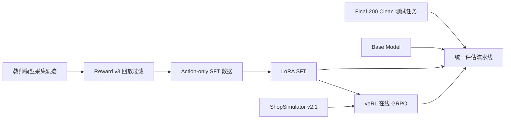
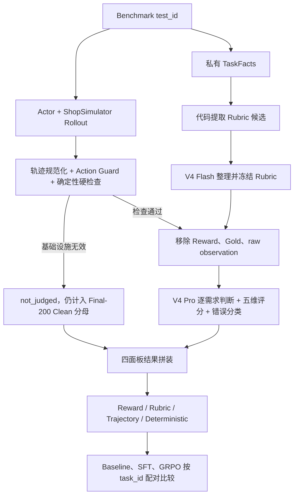

# Shopping GRPO

<div align="center">

**简体中文** · [English](README.en.md)

<br />

面向长程购物 Agent 的可复现后训练与评测项目

<br />

[](pyproject.toml)
[](docs/sft.md)
[](https://github.com/verl-project/verl)
[](https://arxiv.org/pdf/2601.18225)
[](docs/evaluation-dataset.md)

<br />

教师轨迹与 LoRA SFT → veRL 在线 GRPO → Final-200 Clean Benchmark 的可审计对比

<br />

**当前成绩：Qwen3.5-2B + LoRA SFT + GRPO = 128 / 200（64.0%）**
　·　相对 2B 未后训练基线 **0.0%** 提升 64 个百分点
　·　相对纯 SFT（63.5%）再 **+1 题**，且**零回退**（做对的题是 SFT 的严格超集）

</div>

> **本仓库是 [YYHDBL/shopping-grpo-longhorizon](https://github.com/YYHDBL/shopping-grpo-longhorizon) 的 fork。**
> 代码框架、数据协议、Reward v3 与 Final-200 Clean 评测集由原作者建立；本仓库在此基础上完成了
> M1–M12 共十二个阶段的训练配方优化与逐题评测（过程与负结果见[项目历史](docs/project-history.md)）。
> 上游署名与致谢见文末。


## ShopSimulator 是什么？

[ShopSimulator](https://arxiv.org/pdf/2601.18225) 是一个用于评估长程购物
Agent 的大规模中文购物环境。每个任务会给出一段用户需求，其中可能包含商品类别、
预算、品牌、型号、核心功能以及颜色、尺寸、容量、套餐等具体规格。

Agent 不能只生成一句“推荐购买某商品”，而是必须真正与环境交互：

1. 根据需求搜索商品；
2. 打开并比较候选商品；
3. 查看描述、参数和可选规格；
4. 选择正确的商品变体；
5. 购买满足约束的商品，或者在证据充分时合理终止。

这类任务同时考察指令理解、工具调用、长上下文管理、约束满足和终止决策。项目内嵌
了冻结的 ShopSimulator Environment v2.1 源码和商品数据，位于
[`environments/ShopSimulator/`](environments/ShopSimulator/)，不需要用户再单独
克隆或修改一份环境仓库。


## 项目做了什么？

项目按照一条连续的后训练流水线组织：



| 阶段 | 目标 | 入口 | 详细文档 |
|---|---|---|---|
| Baseline | 测量原始 Qwen3.5-2B 的工具使用能力 | `bash scripts/baseline.sh` | [评估](docs/evaluation.md) |
| SFT | 从高质量教师轨迹学习合法、完整的购物行为 | `bash scripts/sft_curriculum.sh` | [SFT](docs/sft.md) |
| GRPO | 在真实环境 Rollout 中优化 Reward v3 | `bash scripts/grpo.sh` | [GRPO](docs/grpo.md) |
| Evaluation | 使用同一批 Final-200 Clean 留出任务公平比较模型 | `bash scripts/evaluate.sh NAME` | [评估](docs/evaluation.md) |

### SFT 数据是怎么收集的？

当前数据使用 `deepseek-v4-flash` 作为教师模型（官方别名，路由到
**DeepSeek-V4.1-Flash**），在 ShopSimulator Environment v2.1 中采集：

- 共获得 2,498 条原始任务轨迹；
- 每条轨迹在采集时都真实执行环境动作，再按 Reward v3 终局结果验收；
- 其中 1,026 条通过严格验收，构成 SFT 基础池；
- 本项目在此基础上做了两轮数据重构（见下方「12 个阶段做了什么」），最终池
  **1,210 条**（train 1,089 / val 121），其中 **144 条（11.9%）含 `next_page`
  翻页示范**——这是 SFT 从 60.5% 提到 63.5% 的主要手段；
- 所有池与 GRPO 训练池、Final-200 Clean 评测集保持 task_id 零重叠。

仓库已提供可断点续跑的采集入口：

```bash
python scripts/collect_sft_data.py \
  --tasks data/grpo/train.jsonl \
  --output-dir outputs/sft-collection \
  --target-accepted 1000 \
  --workers 4
```

SFT 只在 Assistant 动作 token 上计算 Loss，用户指令和环境 Observation 会被
Mask。这样模型学习的是可执行的工具策略，而不是背诵环境返回内容。数据哈希、接受率
和采集审计见[数据采集文档](docs/data-collection.md)。

### GRPO 是怎么训练的？

GRPO 从合并后的 SFT 模型开始。veRL 在 ShopSimulator 中为每个 Prompt 在线生成
四条轨迹，环境用确定性的 Reward v3 评估最终购买结果、约束满足程度和终止行为。
训练不使用额外的 LLM-as-a-Judge Reward Model。

本仓库没有复制 veRL 源码，而是固定安装 `verl==0.8.0`，并保留项目自己的
AgentLoop、工具适配层、运行时兼容代码和一个带 SHA-256 校验的小补丁。详细配置见
[GRPO 文档](docs/grpo.md)。

### 评估流水线是怎么设计的？

正式评估由“代码硬检查 + 两个 LLM-as-Judge + 固定分母聚合”组成。两个 Judge
职责不同：

- **DeepSeek V4 Flash 是 Rubric Curator。** 代码先根据每道题的 Query 和私有
  TaskFacts 提取品类、品牌、型号、功能、规格和价格候选；Flash 只能从候选中选择
  用户真正要求的约束、去重并标注 hard/soft，不能创造新的字段或期望值。生成的
  Rubric 冻结一次，由 Baseline、SFT 和 GRPO 共用。
- **DeepSeek V4 Pro 是 Trajectory Judge。** 它读取用户 Query、冻结 Rubric、
  Actor 实际看到的完整轨迹、中性终局状态和白名单代码指标，逐条判断需求是否满足，
  并从搜索策略、候选利用、证据核验、决策质量、终止效率五个维度分别打 0/1/2 分。

这里的 Rubric 是逐任务评分标准，不是向量检索式 RAG。



以 Final-200 中的 `task_id=8187` 为例，Query 要求“一对卡通-永结同心款的高档
酒红色木梳、礼盒、陪嫁、20 元左右”。代码生成 7 条候选，V4 Flash 冻结为 5 条
Rubric；SFT Actor 用 10 步完成搜索、详情核验、规格选择和购买；V4 Pro 最终给出
`搜索策略 2 / 候选利用 1 / 证据核验 1 / 决策质量 2 / 终止效率 2`，并为每项判断
引用真实的 `event_id`。

Pro 看不到 Reward 分数、Gold 商品私有字段、raw Observation、成功标签或其他模型
结果，因此不能根据答案倒推轨迹质量。最终结果分为四个独立面板：

1. Environment Reward 与终局；
2. Query Rubric 的 hard/soft 满足情况和 Reward disagreement；
3. Pro Judge 五维分布与错误类型；
4. 步数、工具、Guard、重复、上下文和基础设施指标。

四部分不会合成一个总分。缺失、报错和 `not_judged` 任务仍保留在 Final-200 Clean 分母中。
完整数据流、两个模型的完整 Prompt、输入隔离规则、示例 Rubric 和最终统计口径见
[评估流水线文档](docs/evaluation.md)。当前集的筛选依据见
[Final-200 Clean 说明](docs/evaluation-dataset.md)；[Final-200 Dashboard（历史）](docs/evaluation-dashboard.html)
只保留为历史归档。


## 与上游的差异：改了什么、没改什么

本仓库 fork 自 [YYHDBL/shopping-grpo-longhorizon](https://github.com/YYHDBL/shopping-grpo-longhorizon)，
分叉点是上游 `449bba2`（2026-09-22）。**上游已经交付了一套完整的训练配方**——三阶段 SFT 课程、
GRPO 动态采样、Reward v3、Final-200 Clean 评测集。本项目的改动是在这套配方上做增量，
而不是重搭一套。

下面每一条都可对照上游文件核验。

### 教师模型（未改）

| 项 | 取值 | 上游依据 |
|---|---|---|
| 模型 | `deepseek-v4-flash`（官方别名，路由到 **DeepSeek-V4.1-Flash**） | `docs/data-collection.md` |
| 端点 | `https://api.deepseek.com/v1`，凭据 `OPENAI_BASE_URL` / `OPENAI_API_KEY` | 同上 |
| 采样温度 | 0.0 | 同上 |
| 验收 | 每条轨迹真实执行环境动作，再按 Reward v3 终局结果严格验收 | 同上 |
| 产出 | 2,498 条原始轨迹 → 1,026 条通过（41.1%） | 同上 |

> 采集时必须写 `deepseek-v4-flash` 这个字面量，不能换成官方现名 `deepseek-flash`：
> 客户端靠前缀匹配 `deepseek-v4` 来决定是否显式发送 `thinking: disabled`。改名会让模型
> 回落到默认思考模式，多轮对话不回传 `reasoning_content`，工具调用随即崩掉。

### 没改的

| 类别 | 内容 | 上游依据 |
|---|---|---|
| 环境 | ShopSimulator Environment v2.1 源码与 23,421 条商品语料 | `environments/ShopSimulator/` |
| 协议 | 工具 schema v2、observation v2、冻结版 `SYSTEM_PROMPT` | `configs/tools.json`、`configs/prompts/` |
| 评测集 | `data/evaluation/tasks.jsonl` 200 题，每题 1 次确定性 rollout | 上游同文件 |
| 评测口径 | 温度 0.0、`max_steps=35`、渲染前 20 名、BM25 召回 150 | `docs/evaluation.md` |
| **SFT 三阶段课程** | A→B→C，每阶段 1 epoch，lr **1e-4 → 7e-5 → 5e-5**，阶段间在上一阶段 merged 上重开 LoRA | `data/sft_curriculum/manifest.json`、`docs/sft.md` |
| **SFT 结构超参** | LoRA r=16 / α=32 / dropout 0.05、`max_length=24576`、per-device batch 1 × 梯度累积 8、SDPA、梯度检查点 | `docs/sft.md` |
| **GRPO 组大小与采样** | `n=4`、rollout 温度 0.7 / top-p 0.9 | `configs/grpo.yaml`、`docs/grpo.md` |
| 奖励判定逻辑 | hard gate（类别 + 预算）、四维加权 `0.35/0.25/0.25/0.15`、终局离散查表 | `docs/reward-v3.md` |

**三阶段课程、LoRA 结构、组大小这三项都是上游原设计，本项目没有改动。**

### 改了什么

**1. 奖励函数：v3 → v4（M3），v5 写了但未启用（M7）**

| 版本 | 改动内容 | 是否影响 Final-200 分数 |
|---|---|---|
| **v4** | ① 预算解析器重写：中文数字（含「两千五」这类省略末尾单位）、口语单位（块/块钱/圆）、无前缀区间、万缩写、全角与 `\xa0` 空白归一化；价格语境门控拒绝 `SPF50+`、`6g`、`60厘米` 这类误匹配。② 新增两个**纯信息层**：soft 价格接近度、过程证据 `shopping-process-evidence-v1` | **不影响**。hard gate 语义逐字节不变，信息层只写入 `evidence`，不参与终局判定。评测集预算解析率 93.5% |
| **v5** | `wrong_purchase` 由常数 −0.85 改为 band `[−0.85, −0.66]`，按 `match_score` × 预算接近度连续取值 | **不影响，且从未进入最终训练**：Gate 3 实测梯度份额仅 0.3%（门槛 5%），M7 直接关闭 |

一句话：**改的是「预算能不能正确解析」和「训练信号是否够细」，没改「什么算买对」。**

**2. SFT：池子扩容 + 新增监督口径 + 冠军末段微调**

课程结构与超参沿用上游，改的是「读哪些行」和「监督哪几个 token」：

| 项 | 上游 | 本项目 |
|---|---|---|
| 主池 `data/sft_pure_v4/all.jsonl` | **1,192 行** | **1,252 行**（M2 补采 + M4 重建） |
| manifest 划分 | train 1,073 / val 119 | train 1,126 / val 126 |
| 三阶段课程 | A→B→C，每阶段 1 epoch，lr 1e-4→7e-5→5e-5 | **完全相同**（manifest 的 epochs/lr 未改） |
| 行为覆盖 | 以「搜 1 次 → 开第 1 个 → 买」为主（89.2%） | M10-R 追加 144 条（11.9%）`next_page` 翻页示范、候选筛选后回头买、超预算排除；池 1,210 行（1,089 / 121） |
| Loss 口径 | 全局 assistant（自然语言 content 也计入 loss） | 新增 `--loss-scope` 逐回合开关；冠军用 `tool-call-only`（M5 消融：62.0% vs 59.0%） |
| 冠军末段 | 课程到 stage C 结束 | M10-R v2 在 `stage-c/merged` 上再做 **1 epoch、lr 5e-5**，得 63.5% |

**3. GRPO：换训练池 + 六个 override**

上游 `configs/grpo.yaml` 与 `docs/grpo.md` 的取值一致，下表「上游」列即这两处的实际值：

| 参数 | 上游 | 本项目实际 | 理由 |
|---|---|---|---|
| 训练池 `data/grpo/train.jsonl` | **1,000 题** | M4 重建后 906 题 → M12 **223 道中等题**（4 条轨迹里对 1–3 条） | 全对/全错组组内优势恒 0，只耗算力不产方向 |
| `train_batch_size` | 2 | **4** | 每次更新都喂 8 条序列（4×4÷2 = 2×4÷1），学习等价但 4 更快（189 vs 227 s/更新） |
| `max_response_length` | 20480 | **16384** | 实测 `response_length/max = 7500`，从未用满，省 25% 显存 |
| `optim.lr` | **1e-6** | **1e-5** | 1e-6 推不动（M6 零增益），1e-5 下 `ppo_kl` 从 0.0038 单调升到 0.0055 |
| `clip_ratio_high` | 0.20 | **0.28** | 与 `clip_ratio_low` 非对称，放宽正向更新 |
| `calculate_entropy` | true（仅记录，不进 loss） | **false** | bypass 模式下既 OOM 又不产生该指标 |
| `total_training_steps` | 500 | **50** | 223 题 × 50 步 × batch 4 = 200 题次 ≈ 走 0.9 遍 |
| `save_freq` / `test_freq` | 50 / 50 | **25 / 25** | 50 步只留 2 个 checkpoint，25 步粒度才看得到中途 val |
| `rollout.n`（组大小） | 4 | **4（未改）** | 改它会改变算法本身 |

**4. 评测 harness：上游只有单进程入口，本项目新增分片与归因工具**

| 脚本 | 作用 |
|---|---|
| `scripts/eval_sharded.sh` | 200 题切 8 片并发；断点续跑（已完成题跳过）；自动合并 → 报告 → **与指定基线逐题差集** |
| `scripts/compare_teacher_vs_ours.py` | 任意两份 `summary.json` 逐题对比，输出缺口题清单与行为对照 |
| `scripts/label_pool_difficulty.py` | 多轮采样给训练池打「对几条」难度标签，只保留中等题 |
| `scripts/build_candidate_pool.py` | 从未用过的语料行抽候选题，并强制与 SFT / GRPO / 评测集零重叠 |

三条护栏写进脚本而非文档：温度非 0 或本轮不是 200 题时**拒绝**与历史基线相减；
`LABEL=` 必须显式指定（否则会覆盖冠军目录）；`BASELINE_SUMMARY=` 必须显式指定
（自动挑选会挑到分数最高的目录，未必是要比的那个）。

### 可比性：哪些能比、哪些不能

**能比的是最终分数。** 评测集、环境、工具、系统提示词、温度、步数上限全部冻结，
每题 1 次确定性 rollout ⇒ 同一张考卷。

**不能比的是单步改动的归因。** 上游 60.5% → 62.0% 与本项目 62.0% → 64.0% 之间跨了
**SFT 池、GRPO 池、奖励版本**多个变量，因此不能说「我们的 GRPO 比作者强 2 个点」。
本项目的归因链在内部闭环：每个阶段只动一个变量，且始终在同一 reward 口径下评测。

| 模型 | SFT 池 | GRPO 池 | Reward | Strict success |
|---|---|---|---|---:|
| Qwen3.5-2B 未训练 | — | — | v3 | 0.0% |
| **上游** LoRA SFT | 1,192 | — | v3 | 60.5% |
| **上游** GRPO step 100 | 1,192 | 1,000 | v3 | 62.0% |
| 本项目 M5-B（三阶段课程，loss=tool-call-only） | 1,252 | — | v3+v4 | 62.0% |
| **本项目 M10-R v2（最好 SFT）** | 1,210 | — | v4 | **63.5%** |
| **本项目 M12（SFT + GRPO）** | 1,210 | 223 中等 | v4 | **64.0%** |
| Qwen3.8-27B（参考，非本项目产出） | — | — | v3 | 73.0% |

端到端净增 **+2.0pt / +4 题**（62.0% → 64.0%），但如上所述这不是单变量结论。
**真正可归因的增量只有 M12 的逐题「1 进 0 出」**，见下一节。

### 测试历程

12 个阶段（M1 可解性审计 → M12 中等题 GRPO）逐阶段的「做了什么 / 结果 / 落点」见
下方「12 个阶段做了什么」，完整归因与判据见[项目历史 §2 时间线](docs/project-history.md)。
其中 **8 个阶段是负结果**（M6 零增益、M6-R 熔断、M7 Gate 3 未过、M8 靶点被离线解剖否决、
M9 方向否决、M10-R v3 退化、M10-H 难题池空转、M11 查询 A/B 5 换 5），这些比成绩本身更有信息量。

---

## 实验结果

所有结果都在 **Final-200 Clean** 上测：200 道留出任务、每题 1 次确定性 rollout
（temperature 0）、严格口径只认 `gold_purchase` 终局。完整协议、失败分布和产物哈希见
[评测更新记录](docs/evaluation-updates.md)。

### 主线成绩

| 模型 | 严格成功率 | 相对上一行 | 产物 |
|---|---:|---:|---|
| Qwen3.5-2B Baseline（未后训练） | 0.0% | — | — |
| + LoRA SFT（初版） | 60.5% | +60.5pp | `experiments/sft/` |
| + LoRA SFT（行为覆盖重构，M10-R v2） | **63.5%（127/200）** | +3.0pp | `sft-m10r/stage-full/merged` |
| **+ GRPO（中等题池，M12，50 步）** | **64.0%（128/200）** | **+0.5pp** | `grpo-m12-merged` |
| `deepseek-v4-flash`（教师，参考上界） | 73.5%（147/200） | — | — |
| Qwen3.8-27B（参考，非本项目产出） | 73.0% | — | — |

### GRPO 的逐题增量（本项目最核心的结论）

| 项 | 题数 |
|---|---:|
| GRPO 做对 | **128** |
| SFT 基线做对 | 127 |
| 两边都对 | 127 |
| **只有 GRPO 对** | **1** |
| **只有 SFT 对** | **0** |

**GRPO 做对的 128 题是 SFT 127 题的严格超集**——它没有牺牲任何一道原来做对的题，
而是净增 1 题。这是本项目 12 个阶段里**第一次出现非零增量**：此前的 3 轮 GRPO
要么打平（M6）、要么崩掉（M6-R）、要么退化 1 题（M11 探针，做对的 126 题是基线的
真子集）。

> **诚实说明**：+1 题落在二项噪声内（σ ≈ 6.9 题）。**总分层面 64.0% 与 63.5% 不可区分**，
> 能站住的表述是「独有正确题从 0 变成 1」，而不是「成功率提升了 0.5 个百分点」。
> 要在统计上区分，需要 ≥134 题（+7）。

### 这 0.5 个百分点是怎么来的

GRPO 前两轮空转的真因在训练日志里：`group/all_equal_ratio` **0.25–0.50**、
`no_purchase_success_ratio` **0.375–0.75** ⇒ 四分之一到一半的组「4 条轨迹全对」
或「4 条全错」，组内优势恒为 0，**这批题只耗算力不产方向**。

M12 的做法是**只换训练数据**：用两轮采样给候选池打难度标签，只保留「4 条轨迹里
对 1–3 条」的**中等题**（223 道），其余超参一个不动。结果：

| 指标 | 换池前 | 换池后 |
|---|---:|---:|
| `no_purchase_success_ratio`（全错组） | 0.375–0.75 | **0.00** |
| `all_equal_ratio`（零梯度组） | 0.25–0.50 | 0.25 |
| Final-200 | 127 | **128** |

**全错组被彻底清零**，这是「换池子」生效的直接证据。残留的 0.25 全部是「全对组」——
中等题在训练中会退化成简单题，这是该路线的天然上限。

### 训练奖励确实在涨，但涨的是「拟合」不是「能力」

这是本项目最容易被误读的地方，所以单独列出来。训练过程中奖励指标**大幅上升**：

| 指标 | step 25 | step 50 | 变化 |
|---|---:|---:|---:|
| `reward/shaped_mean`（= `critic/score/mean`） | 0.177 | **0.356** | **+101%** |
| `reward/purchase_success_rate`（训练集） | 0.500 | **0.563** | +12.5% 相对 |
| `reward/strict_mean` | 0.500 | 0.563 | +12.5% 相对 |
| val mean@1（49 题留出集） | 0.4477 | **0.4972** | +11.1% 相对 |
| **Final-200（200 题考卷）** | — | **127 → 128** | **+0.8% 相对** |

**三级衰减，每级掉一个数量级**：训练奖励 +101% → 留出 val +11% → 真实考卷 +0.8%。

为什么会这样，逐级解释：

1. **`shaped_mean` 翻倍，主要不是因为「做对了更多题」**，而是因为 **−0.85 的全错组消失了**。
   奖励表里一次错误购买的惩罚是 −0.85，全错组从 37%–75% 清零，均值自然被抬高。
   这是「结构变化」不是「能力增长」。
2. **训练集购买成功率 0.5 → 0.563（+6.3pp）是真实的能力提升**，但它只发生在
   **223 道中等题**这个分布上。
3. **迁移到 Final-200 只剩 +1 题**。这 223 道题是「用当时的模型打标筛出来的」，
   模型在这些题上的进步，有相当一部分是「把已经被标注为可学的题学会了」，
   不等于在没见过的题上更强。

⇒ **奖励是训练信号，不是能力度量。** 这就是为什么本项目所有结论只认 Final-200，
不认训练奖励、也不认 val（M11 探针的 val 涨了 +12.3%，Final-200 却是 0 进 1 出）。

### 试过但没走通的路（同样是资产）

| 方向 | 结果 |
|---|---|
| 换 GRPO 配方（lr 5e-6 → 2e-5） | val 低于起点，step 48 熔断 |
| 推理期强制「买前开 k 个候选」 | 同批 9 题 **7/9 → 0/9**（p≈0.016），方向否决 |
| 教模型「翻页」（144 条合成示范） | 63.5%，但该翻的题只翻 7 道；逐回合补理由反而掉到 61.5% |
| 换系统提示词改查询 | 127/200，净 0（5 换 5 双向抵消） |
| 换难题池（201 道 gold 在 20 名外的题） | 63.5%，逐题只改 2 道 ⇒ 空转 |
| Reward v5（`wrong_purchase` 改 band） | Gate 3 梯度份额 0.3% ≪ 门槛 5%，未开训 |

完整的失败归因、判读铁律与硬约束见 [`docs/project-history.md`](docs/project-history.md)
与 [`docs/lessons-learned.md`](docs/lessons-learned.md)。机器可读的训练配置、结果摘要
和限制说明位于 [`experiments/`](experiments/)。

### 12 个阶段做了什么

| 阶段 | 内容 | 结果 |
|---|---|---|
| **M1** 可解性审计 | 三层审计（有解性 / 检索可达性 / 评分可评性），23,421 条语料 | 建立准入契约，200 题冻结 |
| **M2–M4** 数据与奖励 | 补采、Reward v4、数据重建 | SFT 池成形，四池 task_id 零重叠 |
| **M5** SFT 消融 | assistant vs tool-call-only loss | **62.0%**（tool-call-only 胜，选为 GRPO 起点） |
| **M6 / M6-R** GRPO | lr 5e-6（上游为 1e-6）/ 提到 2e-5 | 62.0% 打平 / step 48 熔断 |
| **M7** Reward v5 | `wrong_purchase` 由常数改 band | Gate 3 梯度份额 0.3% ≪ 5%，**未开训** |
| **M8** 多候选核验 | 计划补 100 条多开轨迹 | 靶点被离线解剖否决，**未开训** |
| **M9** 推理期强制探索 | 买前必须打开 k 个候选 | 同批 9 题 **7/9 → 0/9**，方向否决 |
| **M10 / M10-R** SFT 重构 | 补翻页 / 候选筛选 / 超预算示范 | **63.5%（127/200）**，最长一段时间的冠军 |
| **M10-H** GRPO 难题池 | 201 道「gold 在 20 名外」的题并入池，100 步 | 63.5%，逐题只改 2 道 ⇒ 空转 |
| **M11** 查询提示词 A/B | 只改系统提示词第 3 条 | 127/200，净 0（5 换 5 抵消） |
| **M12** 中等题 GRPO | 223 道「4 条里对 1–3 条」的题，50 步 | **64.0%（128/200），首次非零增量** |

## 训练硬件与耗时

### GRPO（veRL 0.8，单卡）

**显存是硬门槛。** M12 实测（50 步）：

| 项 | 实测值 |
|---|---:|
| `actor/perf/max_memory_allocated_gb` | **41.3 GB** |
| `actor/perf/max_memory_reserved_gb` | **57.1 GB** |

⇒ **48 GB 卡装不下**（可用 47.9 GB）。历史上在 48 GB 上冒烟过，峰值 47,641 / 48,507
= 98.2%，崩在 `logprobs_from_logits → F.log_softmax`（词表 248,320 的输出层是元凶）。
**最低 64 GB，推荐 80 GB 以上**，并且必须设 `PYTORCH_CUDA_ALLOC_CONF=expandable_segments:True`。

| 阶段 | 耗时 |
|---|---:|
| vLLM 初始化（此阶段 GPU util=0 属正常） | 20–25 分钟 |
| 单步（`timing_s/step`） | **140–149 秒** |
| ├ 其中 `update_actor` | **103–105 秒** |
| ├ 其中 `gen`（rollout） | 12–19 秒 |
| └ 其中 `save_checkpoint` | 17 秒 |
| **50 步合计（含初始化）** | **2 小时 23 分钟** |

**墙钟瓶颈在 actor 更新，不在 rollout**——缩短 response 或加大 batch 都省不了多少。

### 评测（与训练分开跑）

2B 模型的评测显存需求远低于训练，**48 GB 卡足够**。但有一条硬约束：
**不能用 Blackwell / sm_120 的卡**（如 RTX 6000D）。torch 的 CUDA < 12.9 会让
`vllm serve` 报 `FlashInfer requires sm75 or higher`，评测根本起不来。
本项目因此把训练与评测拆到两台机器上做。

| 环节 | 耗时 |
|---|---:|
| vLLM 加载合并后的权重 | 20–25 分钟 |
| Final-200 评测（8 分片并发） | **约 25 分钟** |
| 合并 FSDP checkpoint（11 GB → 4.2 GB 权重） | 约 15 分钟 |

### SFT（LoRA）

| 项 | 实测 |
|---|---:|
| 单步 | ~74 秒 |
| 总步数 | 133（kept 1,061 条 ÷ batch 8） |
| 完整训练 | ~2.7 小时 |

### 其他环节

| 环节 | 耗时估算 |
|---|---:|
| Teacher 采集（2,498 条原始轨迹） | 取决于接口并发与限流 |
| 给 1,000 道题打难度标签（2 轮，8 并发） | **约 4 小时** |
| 200 任务评测（Base） | ~20 分钟 |
| 200 任务评测（SFT/GRPO） | ~25 分钟 |
| LLM Judge 评分 200 条轨迹 | ~30–60 分钟 |

## 环境要求

- Linux；
- NVIDIA GPU 和兼容的 CUDA Driver；
- [`uv`](https://docs.astral.sh/uv/)；
- 约 **60 GB** 可用磁盘空间（依赖、模型权重、运行产物；**每个 GRPO checkpoint 约 11 GB**）；
- **SFT**：48 GB 显存足够；
- **GRPO**：最低 **64 GB**，推荐 **80 GB 以上**（实测 `allocated 41.3 GB` / `reserved 57.1 GB`）；
- **评测**：48 GB 足够，但**不能用 Blackwell / sm_120 的卡**（torch CUDA < 12.9 会让
  `vllm serve` 报 `FlashInfer requires sm75 or higher`）。

主训练环境使用 Python 3.12，ShopSimulator 使用隔离的 Python 3.10 环境。
`scripts/setup.sh` 会通过 `uv` 创建并安装两套环境。

## 快速开始

以下命令都在仓库根目录执行。

### 1. 安装

```bash
bash scripts/setup.sh
```

该脚本会安装固定版本的 SFT、veRL 和 vLLM 依赖，创建独立的 ShopSimulator
环境，校验并解压商品数据，构建搜索索引，并应用经过版本和哈希检查的 veRL 补丁。

### 2. 启动 ShopSimulator

在第一个终端运行并保持服务：

```bash
bash scripts/start_environment.sh
```

服务默认监听 `http://127.0.0.1:5700`。

### 3. 运行 Baseline

在第二个终端启动基础模型：

```bash
bash scripts/serve_model.sh Qwen/Qwen3.5-2B
```

在第三个终端评估：

```bash
bash scripts/baseline.sh
```

开始训练前请停止模型服务，释放 GPU 显存。

### 4. 训练并评估 SFT

主路径是三阶段课程（A→B→C，每阶段 1 epoch，lr 1e-4→7e-5→5e-5）：

```bash
# 先只打印六条 train/merge 命令，不加载模型
bash scripts/sft_curriculum.sh --dry-run

# 正式训练
bash scripts/sft_curriculum.sh

bash scripts/serve_model.sh outputs/models/sft-curriculum/stage-c/merged
bash scripts/evaluate.sh sft
```

`scripts/sft.sh` 是单阶段入口（`data/sft/` 1,000 条、3 epoch、lr 1e-4），仅用于复现
上游的历史基线 60.5%，不是主路径。

完成评估后再次停止模型服务。

### 5. 训练 GRPO

先只解析并打印最终命令，不启动 CUDA 或 Ray：

```bash
bash scripts/grpo.sh --dry-run
```

开始训练：

```bash
bash scripts/grpo.sh
```

复现 M12（当前冠军）的完整配置：

```bash
export PYTORCH_CUDA_ALLOC_CONF=expandable_segments:True

bash scripts/grpo.sh \
  --model outputs/models/sft-m10r/stage-full/merged \
  --train-data data/grpo/train_medium.parquet \
  --output outputs/models/grpo-m12 \
  -- \
  data.max_response_length=16384 \
  actor_rollout_ref.actor.calculate_entropy=false \
  actor_rollout_ref.rollout.enforce_eager=true \
  data.train_batch_size=4 \
  actor_rollout_ref.actor.clip_ratio_high=0.28 \
  actor_rollout_ref.actor.optim.lr=1.0e-5 \
  trainer.total_training_steps=50 \
  trainer.save_freq=25 trainer.test_freq=25
```

几个**必设**项，不是可选项：

| 参数 | 理由 |
|---|---|
| `PYTORCH_CUDA_ALLOC_CONF=expandable_segments:True` | 不设会显著抬高 `reserved`，48–64 GB 卡直接 OOM |
| `actor.calculate_entropy=false` | bypass 模式下算熵会 OOM，且该指标不出现 |
| `rollout.enforce_eager=true` | 规避部分新卡的 FlashInfer 兼容问题 |
| `train_batch_size=4` | 每次更新喂 8 条序列（4×4÷2）；batch 2 效果等价但更慢（227 vs 189 s/更新） |

根据验证集指标选择 Checkpoint，并导出 veRL Actor：

```bash
bash scripts/export_grpo.sh \
  outputs/models/grpo/global_step_50/actor \
  outputs/models/grpo-merged
```

> **续训**：数据不变时加 `--resume`（保留优化器状态与 dataloader 位置）；
> **换训练数据时必须重起**（新输出目录 + 用已合并的权重当 `--model`），
> 因为 checkpoint 里的 `data.pt` 是旧数据集的 sampler 状态。

启动并评估导出的模型：

```bash
bash scripts/serve_model.sh outputs/models/grpo-merged
bash scripts/evaluate.sh grpo
```

每次 `evaluate.sh` 完成后会自动生成 `outputs/evaluation/grpo/report.html`。对已有评测结果补生成报告：

```bash
bash scripts/report.sh grpo
```

批量生成所有单模型报告和综合比较报告：

```bash
bash scripts/report_all.sh
```

报告生成器按评测目录读取 `summary.json` 和 `trajectories.jsonl`，模型名与评测参数会从结果中自动填入，因此换模型或换评测标签不需要修改报告代码。

Checkpoint、Rollout 和日志统一写入 Git 忽略的 `outputs/`。

## Reward 设计（v3 → v4）

判定逻辑是一个确定性的终局 Reward，不依赖另一个大模型做主观判断：

- 类别和预算是 Hard Gate；
- 品牌、型号、核心功能、关键规格按照 `0.35 / 0.25 / 0.25 / 0.15` 加权；
- 完全满足并命中目标商品得到 `1.0`；
- 完全满足的替代商品得到 `0.55`；
- 部分满足按照连续分数计算，最高 `0.25`；
- 错误购买、过早放弃、重复循环和达到最大步数都会获得不同负奖励；
- 证据不足时标记为 `reward_valid=false`，不会伪装成有效的零分样本。


**本项目对奖励做的改动只有两处，都不触碰上面这套判定：**

| 版本 | 改动 | 对分数的影响 |
|---|---|---|
| v4（M3） | 重写预算解析器（中文数字 / 口语单位 / 万缩写 / 全角空白 / 价格语境门控），并新增两个纯信息层（soft 价格接近度、过程证据） | 无。hard gate 逐字节不变，信息层只写 `evidence` |
| v5（M7） | `wrong_purchase` 由 −0.85 常数改为 `[−0.85, −0.66]` band | 无，且未启用（Gate 3 梯度份额 0.3% < 5%） |

完整公式见 [Reward v3 设计文档](docs/reward-v3.md)，两处改动的逐条依据见
[Reward v4 变更说明](docs/reward-v4.md) 与 [Reward v5 变更说明](docs/reward-v5.md)。

## 仓库结构

```text
configs/                         当前 GRPO、AgentLoop 和工具配置
data/
  sft/                           SFT 轨迹（基础池 1,026 条 → 本项目重构为 1,210 条：1,089 / 121）
  grpo/                          JSONL 与 veRL Parquet 数据
  evaluation/                    Final-200 Clean 留出任务
docs/                            数据、SFT、GRPO、评估与 Reward 文档
environments/ShopSimulator/      内嵌环境源码和商品数据
experiments/
  baseline/                      Baseline 配置与结果
  sft/                           SFT 配置与结果
  grpo/                          GRPO 配置与结果
scripts/                         面向用户的薄入口脚本
src/shopping_grpo/
  collection/                    Teacher 轨迹验收与 SFT 数据构造
  environment/                   环境客户端、动作、工具和 Observation
  training/sft/                  SFT 数据渲染与 Mask
  training/grpo/                 veRL AgentLoop、适配和动态采样
  evaluation/                    硬检查、Rubric、轨迹 Judge 和指标汇总
tests/                           核心单元、入口和 Wheel 安装检查
```

## 常用配置

| 环境变量 | 默认值 |
|---|---|
| `BASE_MODEL` | `Qwen/Qwen3.5-2B` |
| `SHOPSIM_BASE_URL` | `http://127.0.0.1:5700` |
| `LLM_BASE_URL` | `http://127.0.0.1:8000/v1` |
| `SERVED_MODEL_NAME` | `shopping-agent` |
| `SFT_ADAPTER_DIR` | `outputs/models/sft-lora` |
| `SFT_MERGED_DIR` | `outputs/models/sft-merged` |

GRPO 的高级 Hydra 参数可以追加在 `--` 后：

```bash
bash scripts/grpo.sh -- \
  trainer.total_training_steps=20 \
  trainer.save_freq=10
```

SwanLab 默认关闭，需要时显式启用：

```bash
export SWANLAB_API_KEY=...
bash scripts/grpo.sh --logger swanlab
```

## 文档导航

**先读这两份**：

- [项目历程与问题台账](docs/project-history.md) — 时间线、12 个阶段的完整结果、负结果归因、判据体系
- [经验台账](docs/lessons-learned.md) — 已关闭的路、判读铁律、硬约束、工程坑

分阶段文档：

- [数据采集与数据来源](docs/data-collection.md)
- [LoRA SFT](docs/sft.md)
- [使用 veRL 进行 GRPO](docs/grpo.md)
- [留出集评估](docs/evaluation.md)
- [Final-200 Clean 测试集说明](docs/evaluation-dataset.md)
- [Final-200 Benchmark Dashboard（历史）](docs/evaluation-dashboard.html)
- [Reward v3 设计](docs/reward-v3.md)
- [可审计实验结果](experiments/comparison.md)

## 后续改进计划

### 1. 先做归因，不要先加训练量（零显卡成本）

教师 `deepseek-v4-flash` 是 **147/200**，我们 128/200，**两边并集 165/200 = 82.5%**
⇒ 这不是全面落后，而是互补盲区。真正的增量空间在 **38 道「我们错、老师对」的题**上：

| 失败模式 | 题数 |
|---|---:|
| A 正确商品没进检索结果 | 13 |
| B 商品在结果里但没打开 | 15 |
| **C 打开过还买错** | **0** |
| D 买对商品但选错规格 | 9 |
| E 没买 | 1 |

**C = 0 说明「打开哪一个」是唯一决策点**——一旦打开对了，就不会买错。
下一步应先离线归因这 38 题（只读已有轨迹，不需要显卡），再决定改数据还是改奖励。

### 2. 扩池可能有效，但它是「军备竞赛」

**为什么可能有效（有机制依据，不是盲猜）**：M12 的 223 道题走 0.9 遍后，
`all_equal_ratio` 停在 **0.25**，残留的全是「全对组」——中等题在训练中退化成了简单题。
补充**新的**中等题可以把这个比例压回去，让更多算力产生有效梯度。这条逻辑是清楚的。

**为什么可能无效**：新题的「中等」标签是用**当前冠军**打出来的。训练后模型变强，
这批新题同样会退化。⇒ 扩池不是一次性解决，而是**每轮都要重新打标**，
成本随轮次递增。

**真实预算**：中等题只占候选池 **14%–17%**，打标 1,000 道题 2 轮需 **约 4 小时**。
⇒ **200 道新中等题 = 打标 1,200 道（4 h）+ 训练 4.7 h ≈ 9 小时**。
「抽 200 道就行」是不成立的。

**上限在哪（这决定值不值得做）**：Final-200 里 128 道已对、72 道错，其中只有
**38 道是老师能做对的**（可达），其余 34 道连 `deepseek-v4-flash` 也做不对。
⇒ **扩池的现实目标不是 65%，而是逼近 128 + 38 = 166/200 = 83% 这个可达上界**
（还要扣掉评测集里约 20 道无解题，真实上限更低）。

**我的判断**：扩池是唯一有机制依据的继续方向，但它是一场军备竞赛——每 200 道中等题
花约 9 小时，换来的是「有效梯度窗口延长一轮」，不是永久提升。**如果要做，应该先做
下面第 1 条（38 题归因），确认那 38 题缺的是「训练数据覆盖」还是「2B 的能力上限」**，
再决定要不要投入扩池。

### 3. 评测集的信噪比才是天花板

200 题的二项噪声 **σ ≈ 6.9 题**，意味着**任何小于 7 题的改进都无法在统计上被证实**。
本项目最后两轮的真实增益是 +1 题和 +3 题，都淹没在噪声里。
**扩充评测集（或对同一模型多次采样取均值）比继续微调更能提高结论的可信度。**

### 4. 其他方向

- **扩大模型规模**：2B 在需要商品知识的题上（例如判断该补哪个规格词）有结构性劣势，
  参数量可能是真正的杠杆点。
- **更细粒度的信用分配**：终局奖励稀疏，关键中间步骤（「打开第几个候选」）拿不到信号。
- **混合 Teacher**：单一教师的行为覆盖有限，多教师混合可以扩大行为分布。

## 上游项目与致谢

本仓库 fork 自 [YYHDBL/shopping-grpo-longhorizon](https://github.com/YYHDBL/shopping-grpo-longhorizon)。
上游提供了本项目的基础设施：ShopSimulator 环境封装、工具 schema、数据协议、Reward v3、
Final-200 Clean 评测集与 veRL 训练脚手架。**本仓库的改动集中在后训练配方与数据池**
（SFT 数据重构、GRPO 中等题池、评测脚本与逐题归因工具），不改动环境、奖励与评测口径，
因此两边的分数可以直接比较。

上游本身建立在
[ShopSimulator 论文](https://arxiv.org/pdf/2601.18225)及其开源环境、
[veRL](https://github.com/verl-project/verl) 和
[Qwen](https://github.com/QwenLM/Qwen3) 之上。

评测协议和 Benchmark 构建还参考了
[VitaBench: Benchmarking LLM Agents with Versatile Interactive Tasks in Real-world Applications](https://arxiv.org/pdf/2509.26490)
以及
[EComAgentBench: Benchmarking Shopping Agents on Long-Horizon Tasks with Distributed Hidden Intent](https://arxiv.org/pdf/2606.17698)。

仓库结构参考了
[qiqihezh/agentic-grpo-longhorizon](https://github.com/qiqihezh/agentic-grpo-longhorizon)。
感谢 [OpenCode Go 套餐](https://dev.opencode.ai/go) 对上游开发工作的支持。

### Contributors

**上游作者**

<a href="https://github.com/Guochangwei917">
  
</a>

**本仓库维护**

<a href="https://github.com/Jaxuu">
  
</a>
