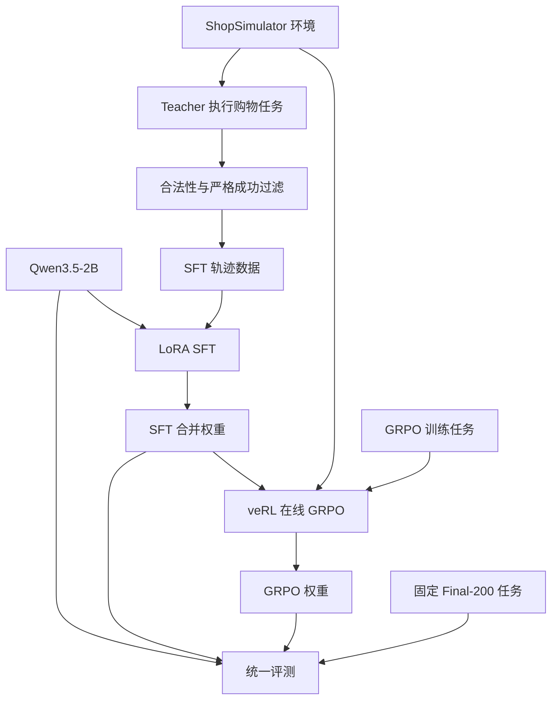

# 从零理解 Shopping GRPO：环境、数据、训练与评测

本文帮助只有少量微调和强化学习基础的读者理解整个项目。阅读顺序是：先理解一次购物交互，再理解交互如何变成训练数据，最后理解 SFT、GRPO 和实验结论。

核对依据包括当前代码、上游分叉点 `449bba2`、后续 Git 提交，以及本地 `plans/` 的报告。`plans/` 被 Git 忽略，不是公开仓库的运行依赖。计划、实际执行和得到证明的结论不是一回事。本文不把计划中的方案视为已完成实验。

当前运行时恢复为 Reward v4，错误购买固定为 −0.85。历史成绩沿用已有记录，没有在本次维护中重训或重新执行 Final-200；部分后期运行的环境版本仍需要原始日志核验，不能用当前配置倒推历史配置。

## 1. 先理解项目在训练什么

项目训练一个能操作购物环境的语言模型。输入是一段中文购物需求，输出不是一篇推荐文章，而是一连串工具调用。

例如用户说：“买一个白色、500ml、100 元以内的保温杯。”模型可能执行：

```text
search_products(query="白色 500ml 保温杯")
→ 环境返回商品列表
open_product(asin="页面上真实出现的商品编号")
→ 环境返回商品详情、规格和按钮
select_option(...)
→ 环境记录所选规格
buy_now(...)
→ 环境检查购买结果，输出终局奖励
```

这里只展示动作含义；完整参数以 `configs/tools.json` 为准。

模型的每次决策都依赖已经看到的内容。搜索结果不合适时，可能需要修改查询、翻页或返回旧页面。这就是任务的多轮和延迟反馈特征。环境最多允许 35 步，但大部分历史轨迹远短于 35 步，不能把“长程”理解成每题都做几十次动作。

几个贯穿全文的概念：

| 名词 | 在本项目中的意思 |
|---|---|
| Task / Prompt | 一道购物任务及其初始输入 |
| Policy / Actor | 当前负责选择动作的模型 |
| Observation | 环境返回、允许模型看到的页面信息 |
| Action | 模型生成并交给环境执行的工具调用 |
| Trajectory | 一道任务从开始到结束的全部交互记录 |
| Rollout | 让模型实际执行任务并生成轨迹的过程 |
| Reward | 根据最终购买或终止状态得到的数值反馈 |
| Checkpoint | 某个训练时刻保存的模型状态 |

## 2. 全链路：有两条信息流



第一条是**执行流**：模型输出工具调用，Harness 检查并执行，环境返回 observation，模型继续决策。

第二条是**训练流**：SFT 用示范动作当标签；GRPO 用当前模型自己生成的轨迹及环境奖励更新参数。评测只测能力，不更新参数。

Teacher 和 Judge 也不同：Teacher 负责生成示范；评测 Judge 负责分析需求满足和轨迹质量。Judge 不给主线 GRPO 提供训练奖励。

## 3. 原作者交付了什么，你的分支改了什么

这里的“原作者实现”指分叉点已有的项目代码，也包含对 ShopSimulator、veRL 等外部项目的集成，不意味着这些底层库是原作者从零编写的。

| 层 | 分叉点已有 | 你的分支主要增量 |
|---|---|---|
| 环境 | ShopSimulator v2.1、商品库、搜索与购买状态机 | 预算解析扩展、审计、过程诊断信息 |
| Agent Harness | 工具 schema、动作守卫、observation 投影、上下文管理 | 特定诊断开关、运行前检查、批处理工程改进 |
| SFT 数据 | Teacher 采集、验收、基础池和课程数据组织 | 高歧义补采、失败动作清理、行为覆盖重构 |
| SFT 训练 | LoRA、Assistant 标签屏蔽、A→B→C 课程与合并 | Tool-call-only 监督口径及消融、单阶段热启动适配 |
| GRPO | veRL 集成、AgentLoop、n=4、多轮 Rollout、动态采样 | 参数与硬件适配、信号诊断、中等任务池筛选 |
| 评测 | Final-200、严格成功统计、Rubric 与轨迹评估框架 | 并发分片、逐题差集、更多失败归因与行为分析 |

不能把 LoRA、三阶段课程、GRPO 算法或 n=4 说成你的创新。你的工作重点是：**利用已有流水线，诊断数据和训练信号，再修改监督目标与采样分布。**

## 4. 环境和 Harness 分别负责什么

环境是商店，Harness 是模型与商店之间的执行程序。

| 组件 | 负责的事 | 主要代码 |
|---|---|---|
| 工具定义 | 告诉模型有哪些动作、参数是什么 | `configs/tools.json` |
| 动作检查 | 检查商品编号是否可见、当前页面能否搜索等 | `src/shopping_grpo/environment/actions.py` |
| 动作转换 | 把模型工具调用转换为环境动作 | `src/shopping_grpo/environment/tools.py` |
| 环境客户端 | reset、step、请求与释放环境实例 | `src/shopping_grpo/environment/client.py` |
| Observation 渲染与投影 | 决定模型看到哪些页面字段，以及长度限制 | `observation.py`、`projection.py` |
| Rollout 循环 | 调模型、执行工具、记录轨迹、处理终止 | `src/shopping_grpo/evaluation/rollout.py` |

模型只能根据可见信息行动。结构化 observation 禁止出现 `goal`、`target_asin`、`reward_detail` 等私有答案字段。环境和评分程序可以知道 gold，Actor 的输入不能因此知道 gold。

GRPO 多条轨迹并发时，每条轨迹需要自己的环境租约。`training/grpo/adapter/session.py` 用协程局部状态绑定环境，并在退出时释放，避免不同购物任务串状态。

搜索使用多字段 BM25。要区分三个数：语料有多少商品、一次查询召回多少候选、页面实际展示多少候选。配置是召回 150、每页 20。目标在召回结果里，不意味着模型已经看到了它；历史生成脚本还记录了连续翻页与循环检测的约束，所以“召回 150”也不能直接当成可执行的浏览上限。

## 5. 奖励：环境如何判断买得对不对

### 5.1 先过硬门槛，再算属性满足

硬门槛是品类和预算。预算使用所选变体的价格，而不是只看商品列表中的一个展示价格。

预算解析器先把自然语言转换为上界。例如“350 到 400 元”取 400；“两千五左右”按既有约定得到 2,750。这里的 10% 容差是项目规则，不能理解成普遍适用的用户偏好。

硬门槛通过后，检查品牌、型号、核心功能和关键规格。只有任务实际激活的维度参与加权：

```text
匹配分 S = Σ(激活维度权重 × 该维度分数) / Σ(激活维度权重)
权重：品牌 .35，型号 .25，功能 .25，规格 .15
```

未要求品牌的任务不会因为品牌维度为零而被扣相应分数。完整满足还要求证据覆盖充分。

### 5.2 终局奖励与成功指标

| 终局 | 当前奖励 |
|---|---:|
| gold 商品且要求全部满足 | 1.00 |
| 其他商品但要求全部满足 | 0.55 |
| 部分满足的替代购买 | `min(.25, -.30 + .55 × S)` |
| 搜索充分后的合理停止 | −0.15 |
| 过早放弃 | −0.35 |
| 35 步耗尽 | −0.50 |
| 重复或无进展循环 | −0.65 |
| 预算或品类失败 | −0.85 |
| 无法核验 | 0，但 `reward_valid=false` |

严格成功要求完整的 `gold_purchase` 终局及有效奖励。合法替代商品虽然有正奖励，仍不计入严格成功率。`done` 只表示结束，买错和循环也可能结束；奖励为零也不等于成功。

### 5.3 你的奖励相关改动

预算解析扩展了中文数字、口语金额、区间、空白归一化和价格语境检查。过程证据与软价格接近度作为诊断字段写入，不直接增加终局奖励。

“比较规则不变”不意味着“所有任务分数不变”。即使比较函数始终是 `actual <= upper`，解析出的 upper 改变，也可能改变预算门槛结果。必须重放和分版本核对。

本地核对 Final-200 为 187/200，解析率 93.5%；仓库保留的旧解析器快照在该集合上也是 187/200。扩展的主要意义不能用“评测集覆盖率从旧值提升到 93.5%”来证明。解析非空率也不是解析准确率，多金额作用域仍是规则方法的局限。

## 6. SFT 数据怎么产生

### 6.1 Teacher 负责示范，环境负责验收

Teacher 收到训练任务后，实际调用工具完成购物。收集程序保存对话、动作和终局，按环境奖励验收，不是让 Teacher 自称“买对了”就算成功。

上游早期采集记录是 2,498 条原始轨迹、1,026 条严格验收通过，另有 1,000 条冻结子集。后来的 pure 池是另一阶段的数据资产，不能把所有历史数字当成同一份数据。

训练前必须排除 Final-200 的 task_id，并按任务划分训练与验证，避免同一道题的多条轨迹分到两边。task_id 不重叠仍不能证明同商品或同语义需求完全不重叠。

### 6.2 M1—M4 做了什么

M1 以 23,421 条商品/任务语料为背景，重点对当时四个数据集的 2,442 条任务做逐任务审计。三层分别是：目标规格是否有解、查询能否召回目标、正确购买能否被奖励核验。

初始四池是 evaluation 200、SFT 1,192、GRPO train 1,000、GRPO val 50。审计后训练任务被清理；M4 记录 GRPO train 906、val 49。

M2 补采 100 条高歧义成功轨迹。M4 发现其中 41 条含被守卫拒绝的动作。对于明确未执行、未改变环境状态的动作，删除对应 Assistant 回合与拒绝 observation 对，再校验剩余路径，避免把非法动作也当标签学习。

M4 的 SFT 池从清理后的 1,152 加 100 得到 1,252，记录划分为 train 1,126、val 126。M5 的部分记录又写实际 1,115 条训练数据；这两个数字不能未经 token 化统计核对就混用。原始池行数、manifest 选中行数和最终可训练样本数是三种统计。

### 6.3 为什么不能只保留“最后买对”的轨迹

一条轨迹可能中间瞎点、收到错误、反复搜索，最后碰巧买对。直接监督整条会把坏动作一并学走。所以成功验收、动作合法性检查和行为质量检查分别有作用。

## 7. SFT 实际如何学习：看见不等于监督

SFT 是“给定当时上下文，提高示范答案 token 的预测概率”。多轮轨迹整体进入模型，但不对所有 token 计算损失。

```text
system：工具规则                         labels = -100
user：购物要求                           labels = -100
assistant：自然语言 + search_products     视监督口径决定
tool：搜索结果                           labels = -100
assistant：open_product                  工具调用 token 参与 loss
tool：商品详情                           labels = -100
assistant：select_option / buy_now        工具调用 token 参与 loss
```

`-100` 是忽略标签的标记。Observation 仍然作为上下文影响动作预测；屏蔽它的 loss，不是把它从输入中删除。

简化目标为：

```text
SFT loss = 对被监督 token 的 -log P(示范 token | 之前的上下文) 求平均
```

### 7.1 两种监督范围

| 模式 | Assistant 自然语言 | 工具调用 | 用户与 observation |
|---|---|---|---|
| assistant | 监督 | 监督 | 不监督 |
| tool-call-only | 不监督 | 监督 | 不监督 |

`training/sft/dataset.py` 通过 chat template 渲染确定边界。Tool-call-only 会把同一回合去掉 tool_calls 后重新渲染，用 token 公共前后缀定位插入的调用载荷，而不是手写模型特殊 token。

超长样本被丢弃，不随意截断，以免留下不完整调用或失去终局。不同 mask 的 loss 不能直接比较，因为预测目标和分母不同。

M5 的记录是 assistant 59.0%、tool-call-only 62.0%，后者 Guard 拒绝更少。本次实验支持选用 tool-call-only，但没有多种子验证，不能推出“自然语言监督对所有 Agent 都有害”。

## 8. LoRA 和课程训练改变了哪些参数

LoRA 冻结基础权重 W，只训练一个低秩增量：

```text
W_effective = W + (alpha / r) × B × A
```

A、B 比完整 W 的参数少，所以需要更新的梯度和优化器状态少。但长序列仍需保存激活，计算大词表 logits，Rollout 还需要 KV cache；“LoRA 参数少”不等于整个训练显存低。

上游配方是 r=16、alpha=32、dropout=.05，最大序列 24,576，单卡 batch 1、梯度累积 8。它们是继承的配方，不是本分支新提出的超参。

上游三阶段课程：

| 阶段 | 数据 | 学习率 | 后续步骤 |
|---|---|---:|---|
| A | foundation | 1e-4 | 训练 adapter，合并进基座 |
| B | foundation + constraints | 7e-5 | 在 A 的 merged 上新建 LoRA，再合并 |
| C | 全部训练桶 | 5e-5 | 在 B 的 merged 上新建 LoRA，再合并 |

基础桶会被看到三阶段，约束桶两阶段，策略桶一阶段。每阶段“1 epoch”不是全池只出现一次。

合并把当前增量写入基础模型，方便下游服务和 RL 加载；下一阶段重新挂 LoRA 时，之前学到的增量已经保存在 merged 权重中。重新挂 adapter 会重建其训练状态，不等于从中断点 resume。

## 9. 后续 SFT 为什么转向行为覆盖

历史诊断发现大量数据是“搜一次、开一个、选规格、买”。模型也偏好类似动作模式。但这种相关性不能单独证明所有选择错误都由数据比例造成。

补采按预设查询名次选题时，Teacher 自己会写不同查询，原来预计需要翻页的题可能第一页就能解决。正确方法是按实际轨迹筛选，而不是只按选题时的假设判断示范是否覆盖目标能力。

翻页示范不足时，脚本用训练题的 gold 信息构造成功路径，再实际执行环境并校验终局。这属于利用训练答案构造的示范；需要确保 Actor 输入中无私有答案，并检查动作能否由当时的可见证据支持。

重构后的池记录为 1,210 行，train 1,089、val 121，其中 144 行含 next_page。`prev_page` 在这里常表示从详情页返回列表，不能一并计为“翻到搜索结果下一页”。

历史主要尝试：

| 方案 | 实际变化 | 记录结果与边界 |
|---|---|---|
| M10-R v1 | 从基础模型先探索子集、再全量池 | 中间模型 43.5%，终版 63.0%；强探索与基本策略发生权衡 |
| M10-R v2 | 从 M5-B 62% 的 merged 热启动，新 LoRA、全量单阶段 1 epoch、lr 5e-5 | 63.5%；与 v1 同时改变起点和阶段组织，不是严格单变量消融 |
| M10-R v3 | 对翻页轨迹补理由，并启用回合级 Assistant 监督 | 61.5%；本配方退化，不能证明所有理由监督无效 |

v2 的轨迹级翻页率记录为 6%，数据中为 11.9%。但数据决策点的翻页占比约 7.4%。一条长轨迹包含许多不翻页决策，所以“多少条含翻页”不等于“每次决策多大概率翻页”。即使总体频率接近，也不能证明模型学会了何时该翻。

## 10. GRPO 和 SFT 的根本区别

SFT 的信号是“老师示范了哪个动作”；GRPO 的信号是“同一道题，自己生成的哪些轨迹结果更好”。

一次简化流程：

```text
抽取若干训练任务
→ 每题用当前策略采样 4 条独立轨迹
→ 真实执行环境，获得终局奖励
→ 检查无效轨迹与组内奖励差异
→ 对有用组计算优势
→ 用裁剪策略目标更新 LoRA
→ 同步权重给 vLLM
→ 下一批任务
```

RL 训练集主要提供任务、初始 prompt 和 task_id，不像 SFT 那样必须有完整标准答案轨迹。轨迹在线生成，所以训练数据分布随模型变化。

### 10.1 本项目实际的优势公式

配置 `norm_adv_by_std_in_grpo=false`，所以不是默认背诵“减均值再除标准差”，而是：

```text
A_i = r_i - mean(r_1, r_2, r_3, r_4)
```

| 四条奖励 | 均值 | 四条优势 |
|---|---:|---|
| 1, 1, −.85, −.85 | .075 | .925, .925, −.925, −.925 |
| −.85, −.85, −.85, −.85 | −.85 | 0, 0, 0, 0 |
| −.85, −.65, −.50, −.35 | −.5875 | −.2625, −.0625, .0875, .2375 |

第三行四条都未严格成功，却有优势信号。所以“全错组”和“零方差组”不相同。四条全 gold 时奖励同为 1，才是全成功且零优势的典型例子。

“没有信号”准确指该组在相对奖励策略目标上的贡献，不是说整个训练一定没有其他正则项。本配置额外 KL 奖励、KL loss 与熵系数均关闭。

### 10.2 PPO 裁剪在做什么

对策略生成的 token，计算当前策略相对采样策略的概率比 rho：

```text
rho_t = exp(log pi_current(token_t) - log pi_sample(token_t))
目标项 = min(rho_t × A, clip(rho_t, 1-eps_low, 1+eps_high) × A)
```

正优势轨迹鼓励提高动作概率，负优势轨迹鼓励降低。裁剪限制局部概率比更新的激励，不是硬性限制参数距离，更不保证不回退。

终局优势在常规路径中作用于整条轨迹的策略 token，不能精确知道“第几步造成失败”。因此本项目仍有粗粒度信用分配问题。`shopping_trace.enable=false`，不能把仓库里存在的 trace 辅助机制说成最终已启用的过程奖励方案。

`bypass_mode=true` 使用 Rollout 提供的 log probability 作为旧策略概率，减少重算。训练引擎和推理引擎存在数值差异时，PPO 近似 KL 可能混有误差；它也不是显式对 reference model 的 KL 正则。

### 10.3 动态采样与离线筛选

动态采样在轨迹生成后，整组过滤无效或终局奖励恒定的组，避免无效更新。最多重采三批，连续跳过更新有上限，防止死循环。

离线筛选在生成前改变任务采样分布，提高抽到有用任务的概率。它的价值包括减少无用 Rollout、把预算集中在可学习任务上；不是发明了新的 GRPO 优势公式。

两者都不能保证效果提升：有方差可能只是多个错误结局之间的差异；通过筛选的组也可能缺少通向正确购买的探索。

## 11. 后续 GRPO 实验实际发生了什么

| 阶段 | 设计 | 记录结果 | 能支持的结论 |
|---|---|---|---|
| M6 | M5-B 起点，lr 5e-6，50 步 | 62.0% | 该次运行总分无净提升，不能说完全没更新 |
| M6-R | lr 提到 2e-5 | 验证退化，step 48 连续跳过熔断 | 该次加大学习率没有带来可用收益 |
| 离线奖励诊断 | 检查细化失败奖励是否能产生足够组内信号 | 没通过开训检查 | 未启动独立实验，不能当作训练改进成绩 |
| M10-H | 加入 201 道需要翻页的题，混成 401 题池 | 100 步仍 63.5%，相对 SFT 逐题 +1/−1 | 更难的题不自动意味着更有效的训练信号 |
| M11 探针 | 401 题，lr 1e-5，25 步 | 126/200 | 该次评测有一题回退 |
| M12 | 换为 223 条中等任务，lr 1e-5，50 步 | 128/200，相对 SFT 127 题为 +1/−0 | 本次有限增量，尚无显著性或多种子证据 |

### 11.1 223 道题是怎么来的

`plans/m11-grpo-medium-runbook.md` 记录实际是两轮采样，温度 .7：401 题中筛 57 道、随机 1,000 题中筛 166 道，合并为 223。两轮都有结果时，“中等”表示一次成功、一次失败；不是四次中成功一到三次。`select` 的代码按实际观察到的条数分桶，缺轮时必须额外核对。

打标模型是 `grpo-m11-merged`，训练起点是 SFT v2 的 merged。两者并非同一权重；Final 分数接近不能保证逐题难度标签完全相同。

若每条成功概率为 p、独立采样 n 条，观察到成功与失败混合的概率为：

```text
1 - p^n - (1-p)^n
```

p=.5 时两条只有 50% 的概率显示混合，四条为 87.5%。有限采样会漏掉中等题，也会选入偶然混合的题。筛选不是任务“真实难度”的精确测量。

### 11.2 不能称为严格单变量实验

M11 探针 25 步，M12 50 步，模型更新总量也改变。M12 的 step 25 本可以提供同训练量对照，但报告记录该 checkpoint 在完整比较前已删除。因此不能把最终差异完全归因为换池。

`50 × batch 4 = 200` 是训练批次中的 prompt 组次数量估计，不是所有环境执行次数，也不是 200 个不同任务。每组有四条轨迹，动态采样还会产生丢弃组，mini-batch 还会拆分更新。所以“不到一遍”不能证明不过拟合。

报告 step 25 的 `no_purchase_success_ratio=.083`，step 50 为 0；`all_equal_ratio` 仍为 .25。只能说记录的后期采样点没有购买成功的组比例降到零，不能说整场训练零全错组，更不能说消除了零信号组。该指标按 purchase success 统计，也不同于筛题采用的严格 gold success。

## 12. 评测怎么理解，哪些说法要收紧

### 12.1 四种指标不要混在一起

| 指标 | 回答的问题 |
|---|---|
| strict success | 是否有效完成 gold_purchase |
| purchase success | 是否完成 gold 或完全满足要求的替代购买 |
| mean reward | 按当前奖励数值表，平均终局价值是多少 |
| Judge/行为指标 | 满足哪些需求、如何利用证据、哪里浪费步骤 |

Rubric Curator 整理代码产生的候选需求，Trajectory Judge 阅读经过隔离的轨迹和标准。它们提供额外诊断；不能用 Judge 的评分代替严格成功，更不能称为 GRPO 训练中的 Reward Model。

缺题、基础设施错误和未完成任务保留在固定分母中，避免模型出错越多、剔除后分数反而越高。基础设施失败还需单列，以区分模型能力与系统可用性。

### 12.2 64% 可以说，但不能扩大解释

记录中的 SFT 为 127/200，GRPO 为 128/200，共同正确 127，只有 GRPO 正确 1，只有 SFT 正确 0。

这证明该次固定题集的结果有上述差异，不证明总体能力显著提升。一个不一致样本的双侧精确 McNemar 检验 p=1；“没有回退”也不排除偶然性。

单模型总成功数的二项标准差不是两模型配对差异的标准误；“差七题就显著”等固定阈值没有普遍依据。需要多种子训练、配对分析和独立测试。

### 12.3 任务不重叠与开发过程独立是两件事

历史流程多次查看 Final-200 来选择方向。即使从未把测试 task_id 加入训练，仍存在利用测试反馈反复调方案的自适应过拟合风险。更严格的后续流程需要独立开发集，以及不参与调参的新盲测集。

历史报告还提出“20 道疑似无解题”，并尝试 /180 重算。买到 gold 却失败只能作为线索，还需确认变体、预算和评分逻辑，不能仅凭多模型失败证明无解。主报告仍维持冻结的 /200；审计子集应作为附加视角，并提前冻结规则，不能事后换分母提分。

## 13. 把全部优化过程串成因果链

```text
基础模型不稳定调用工具
→ 先沿用上游环境、数据与 SFT/GRPO 框架
→ 审计发现训练任务和预算解析有质量问题
→ 清理任务、补采成功示范、修复非法动作监督
→ 对比监督范围，Tool-call-only 本次效果更好
→ GRPO 收益有限，继续检查组内奖励和行为差异
→ 强制探索、补示范、补理由并未稳定改善候选选择
→ 翻页数据重构得到 63.5% SFT，但多候选决策仍是短板
→ 难题池 GRPO 仍难产生收益
→ 改筛有成功也有失败的训练任务
→ M12 本次得到 64%，但只多一题，保留效果边界
```

这条链体现的是不断定位问题，而不是每个阶段都成功。不能把被诊断否决的想法写成已实现收益，也不能把阶段编号多等同于实验结论强。

历史材料里尤其需要避免的推断：有零方差不等于没有足够有效组；有有效组不等于方向正确；相同总分不等于策略完全不变；验证 reward 上涨不等于严格成功率上涨；两模型分数接近不等于标签可完全迁移；单次负结果不等于该方向永久无效。

## 14. 建议怎样读代码，才不只是背结论

按下面顺序，每次只走通一个例子：

1. `configs/tools.json`、`environment/observation.py`：写下模型实际能看到和能做什么。
2. `evaluation/rollout.py`、`environment/actions.py`：跟一次 search 到 buy，找出非法动作在哪被拒绝。
3. 环境 `engine/reward.py`：手算一个成功购买、一个超预算购买、一个合法替代购买。
4. `collection/sft.py`：找出成功轨迹如何变成 messages，以及哪些轨迹被拒收。
5. `training/sft/dataset.py`：手画一条轨迹，标出 input token 与被监督 token 的区别。
6. `scripts/train_lora_sft.py`、`scripts/run_sft_curriculum.py`：确认基座、adapter、merged 与 resume 各是什么。
7. `training/grpo/adapter/agent_loop.py`、`session.py`、`runtime.py`：跟踪一次在线 Rollout 的环境、奖励与状态。
8. `training/grpo/dynamic_sampling.py`：用四个奖励手算优势，再看组如何被保留或丢弃。
9. `scripts/label_pool_difficulty.py`：核对采样轮数、正确条数、筛选阈值和防重叠逻辑。
10. `evaluation/metrics.py`、`summary.py`：确认成功分子、固定分母和错误任务如何统计。

如果能不用看稿解释下面五件事，就已经掌握了项目的主要机制：

- Observation 被 mask 后为什么仍然能影响模型？
- 为什么四条都失败也可能产生 GRPO 优势？
- 为什么有动态采样还可能需要离线筛任务？
- 为什么 144 条翻页数据不等于模型会正确选择翻页时机？
- 为什么 128/200 相比 127/200 是观察到的增量，而不是显著提升的证明？

## 15. 证据入口与还缺少的材料

| 主题 | 关键提交或文件 |
|---|---|
| 上游基线 | `449bba2`，查看该提交下的 docs、configs、src |
| 审计与解析 | `f8aae29`；`scripts/audit_solvability.py` |
| 预算与诊断信息版本化 | `d4e4e41`；`docs/reward-v4.md` |
| 数据修复与重建 | `c8b5b88`；本地 `plans/m4-rebuild-report.md` |
| SFT 监督口径与结果 | `3bf597a`、`2c24e1a`；`experiments/sft-m5/` |
| 翻页生成与热启动方案 | `dc68bd5`、`b62be2f`；本地 `plans/m10r-result.md` |
| 中等题筛选与合并 | `79d3bbb`、`f9adab4`；`scripts/label_pool_difficulty.py` |
| M12 结果记录 | `6ab8c08`；本地 `plans/m11-grpo-medium-runbook.md` |

本地未找到最终 capped 完整数据、223 题 parquet，以及 M10-R v2、M12 的完整评测摘要与轨迹。已有报告能帮助还原过程，但不等于原始产物的独立验证。要核实历史奖励版本、逐题 +1/−0 和训练过程指标，还需要服务器当时保存的 run config、diagnostics、environment manifest 与 trajectories。

当前可执行代码、历史报告和生成某次成绩时的服务器状态，是三个不同对象。学习和面试时都应明确自己依据的是哪一种。
